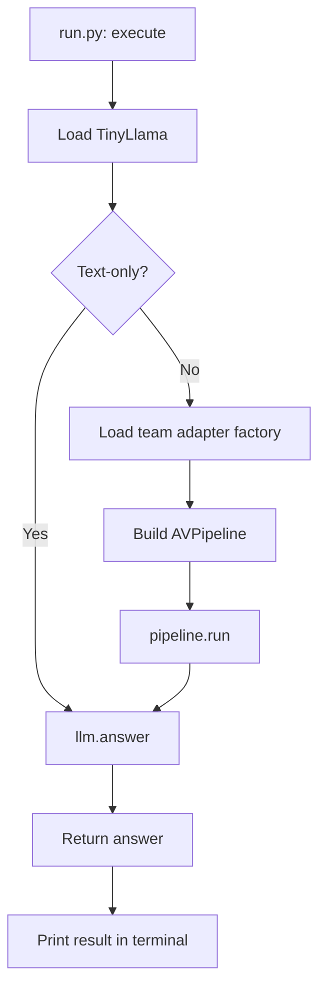
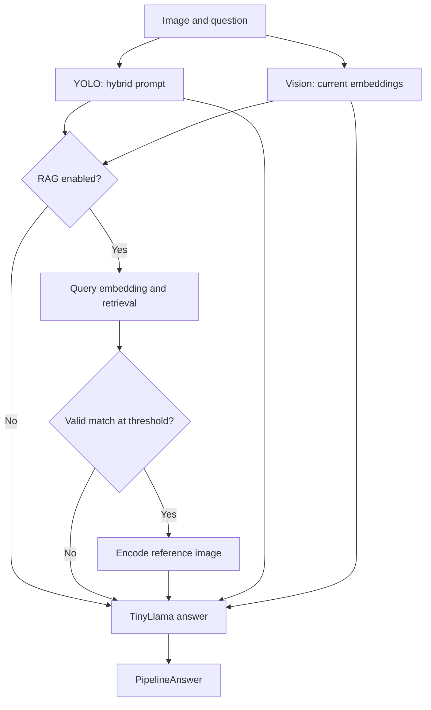

# How the pipeline and Nsight files connect

This guide describes the updated `tinyllama_nsight_systems` code. Start with
`run.py` for both normal inference and occasional benchmarking. The inference
path stays the same; `--benchmark` adds an observer and launches the program
through NVIDIA Nsight Systems.

## 1. What each file does

| File | Responsibility | Main connections |
|---|---|---|
| `run.py` | Reads options, loads the LLM, builds the pipeline, and prints answers | Calls `TinyLlamaStage`, the team's adapter factory, and `AVPipeline`; optionally calls `benchmark_nsight.launch()` |
| `pipeline.py` | Passes the question and image through YOLO, vision encoding, optional RAG, and TinyLlama | Uses the objects supplied by `run.py` and returns `PipelineAnswer` |
| `tinyllama_stage.py` | Loads TinyLlama, embeds retrieval queries, prepares model inputs, and generates answer tokens | Returns `StageAnswer`; calls the optional observer during `answer()` |
| `adapters.py` | Wraps the team's functions in the interfaces the pipeline expects | Defines `YoloAdapter`, `VisionAdapter`, and `RagAdapter` |
| `contracts.py` | Defines shared data structures and interface expectations | Supplies `VisualOutput`, `RagHit`, `StageAnswer`, and `PipelineAnswer` |
| `benchmark_nsight.py` | Starts `nsys` and a child copy of `run.py` | Preserves input options and retains only the final `.nsys-rep` file |
| `nsight_buffer.py` | Adds NVTX labels, token timing, and CPU/RAM observations | Observes the pipeline and LLM without replacing their returned data |
| `requirements.txt` | Lists the original Python library dependencies | Used during environment setup, not during every inference request |

`requirements.txt` does not install the NVIDIA driver, Nsight Systems, or the
appropriate CUDA-enabled PyTorch build. Those must already work on your machine.

## 2. Normal execution

When `--benchmark` is absent, `run.py` calls `execute(args)` directly.

1. `TinyLlamaStage(...)` loads the local LLM checkpoint and tokenizer.
2. In text-only mode, `call_once()` calls `llm.answer(...)` directly.
3. In pipeline mode, `run.py` loads the adapter factory and builds `AVPipeline`.
4. `call_once()` calls `pipeline.run(...)`.
5. The returned dataclass is converted to JSON and printed to the terminal.

Normal mode does not launch `nsys`, install the benchmarking hooks, start the
resource monitor, or write a benchmark report. Printing JSON to the terminal
is not the same as exporting a JSON file.



## 3. What happens inside the pipeline

`AVPipeline` coordinates the components. It does not implement YOLO, CLIP,
the projector, or the retrieval database itself.

| Order | Actual call | Data passed to the next step |
|---|---|---|
| 1 | `yolo.hybrid_prompt(image_path, question)` | A text prompt combining the question and detected objects |
| 2 | `vision.encode(image_path, role='current')` | Current-image embeddings and, optionally, a CLIP retrieval vector |
| 3 | `llm.embed_query(hybrid)` or `current.retrieval_embedding` | A query vector matching the RAG bank's encoder |
| 4 | `rag.retrieve(hybrid, query)` | A candidate `RagHit`, or `None` |
| 5 | Validate the candidate and compare similarity with the threshold | An accepted reference, or no reference |
| 6 | `vision.encode(hit.image_path, role='retrieved')` | Projected reference-image embeddings, if the reference was accepted |
| 7 | `llm.answer(...)` | Generated text, token IDs, and a finish reason |
| 8 | Construct `PipelineAnswer(...)` | The answer, hybrid prompt, and accepted reference ID |

Steps 3–6 are skipped when no RAG object is supplied. A candidate must meet the
default similarity threshold of **0.7**. If it is rejected, both its image and
its description are omitted from the final LLM input.



TinyLlama's visual-input order is **retrieved image tokens, current image tokens,
then chat text tokens**. The retrieved tokens are optional. The projector and
LLM must have been trained for the intended pairing; matching tensor dimensions
alone does not establish that the model understands those visual inputs.

## 4. How the team's adapters connect

This option identifies a Python module and a function:

```bash
--adapters team_adapters:build
```

`run.py` effectively performs:

```python
module = importlib.import_module('team_adapters')
components = module.build(llm)
pipeline = AVPipeline(llm, **components, ...)
```

The factory must return a dictionary containing `yolo`, `vision`, and optionally
`rag`. The following illustrates the expected structure; it is not a complete
adapter implementation:

```python
return {
    'yolo': your_yolo_object,
    'vision': your_vision_object,
    'rag': your_rag_object,  # Use None, or omit this key, to disable RAG.
}
```

`adapters.py` can wrap existing team functions so they expose these methods:

| Component | Required interface |
|---|---|
| YOLO | `hybrid_prompt(image_path, question)` returns nonempty text |
| Vision | `encode(image_path, role=...)` returns `VisualOutput`; also provides `alignment_id` |
| RAG | `retrieve(hybrid_prompt, query_embedding)` returns `RagHit` or `None`; also provides `query_mode` and `embedding_id` |

The visual alignment ID must agree with the loaded alignment manifest. The
RAG embedding ID and query mode must agree with the encoder used to create the
stored bank. Text-query and CLIP-query vectors are not interchangeable.

**Still supplied by the team:** actual adapters, YOLO/vision/projector weights,
a compatible trained visual alignment manifest, and the RAG bank if enabled.
The included wrappers do not provide these implementations or assets.

## 5. What changes when benchmarking is enabled

Adding `--benchmark results/test_01.nsys-rep` changes how the program is launched,
not the model's generation implementation.

1. The original `run.py` process calls `benchmark_nsight.launch(args)` before
   loading ML models.
2. The launcher starts `nsys profile`, which starts a child `run.py` with the
   internal `--profile-worker` option. Do not supply that option yourself.
3. The child loads the same LLM and adapter configuration.
4. It performs the requested warm-up calls without capture. The default is one.
5. `torch.cuda.profiler.start()` starts collection.
6. Each measured request gets a fresh `NsightBuffer` and runs through the same
   `call_once()` used in normal mode.
7. `torch.cuda.profiler.stop()` ends collection; answers are printed afterward.
8. Once Nsight finishes, the launcher copies the native report to the requested
   filename and removes temporary intermediate files.

`--runs` controls measured repetitions. Its default is one. Models are loaded
once per child process, not once per repeated request. Warm-up repeats the real
pipeline, so stateful team adapters should be designed with that behavior in mind.

Only the `.nsys-rep` report is retained as a benchmark output. No CSV, JSON, or
text-log export is produced by this workflow. Nsight may use temporary files
while collecting and processing the trace.

## 6. How the observer reaches TinyLlama

The same observer object follows this call path:

```python
# run.py
observer = NsightBuffer(args.interval_ms)
with observer.pipeline_scope(llm, 'request_1'):
    call_once(observer)

# call_once(), in pipeline mode
pipeline.run(..., benchmark=observer)

# pipeline.py
llm.answer(..., benchmark=observer)

# tinyllama_stage.py
with benchmark.request(self):
    return self._answer_impl(..., benchmark=benchmark)
```

`pipeline_scope()` brackets the whole request and starts the CPU/RAM monitoring
thread. `pipeline.py` uses `observer.span(...)` to label the individual stages.
`request()` installs LLM forward hooks and records LLM token timing. These are
different scopes: **pipeline latency includes upstream work; LLM latency does not**.

Inside the existing generation loop, `input_ready()` records the input-token
count and `token_ready()` records when each selected token reaches the CPU.
Neither function replaces inputs, tokens, or the model's answer.

### Who calls the before/after hooks?

`nsight_buffer.py` registers `before()` and `after()` with PyTorch:

```python
module.register_forward_pre_hook(before)
module.register_forward_hook(after, always_call=True)
```

When `tinyllama_stage.py` calls `self.model(...)`, **PyTorch calls those hooks
automatically** around the model's forward execution. Transformer-block calls
trigger their own registered hooks. There is no explicit `before()` call in
`pipeline.py` or in the generation loop.

The first model forward receives the `prefill` label. Later forwards receive
`decode`. Blocks receive names such as `block_00`. The hooks return no replacement
values and are removed when the request finishes, including on an inference error.

## 7. What to look for inside the report

| Label or track | Meaning |
|---|---|
| `request_1`, `request_2`, etc. | Outer request ranges |
| `yolo` | Detection/hybrid-prompt call |
| `vision_current` | Current-image encoding and validation |
| `rag_query_embedding` | Retrieval query preparation |
| `rag_search` | Search and candidate validation |
| `vision_reference` | Accepted reference-image encoding |
| `llm_answer` | Final LLM answer wrapper in pipeline mode |
| `prefill`, `decode`, `block_XX` | LLM forward and block ranges |
| `pipeline_latency_ms=...` | Whole-request duration with model-device synchronization at its boundaries |
| `application ...` | LLM latency, input/output counts, TTFT, TPOT, and output tokens/s |
| `resources ...` | Sampled CPU usage, process RSS, system RAM, and swap readings |
| `pytorch_gpu_memory ...` | PyTorch allocator memory values on the LLM device |
| CUDA/GPU timeline tracks | Native kernel, CUDA API, and memory activity captured by Nsight |

CPU/RAM readings and the application measurements are **NVTX text annotations**,
not automatic numeric charts. Inspect the NVTX event details in Nsight Systems.
Optional `--gpu-metrics-device all` and `--cpu-sampling` request additional native
channels where supported and permitted by the platform.

Interpretation details:

- TTFT ends when the first selected token reaches the CPU, not when a word is displayed.
- TPOT averages intervals after the first token; it is `None` for a single output token.
- Generated EOS tokens count toward the output-token count.
- Process CPU usage uses 100% for one busy core and may exceed 100%.
- Under WSL, system CPU/RAM readings describe the Linux VM, not all of Windows.
- CPU/RAM polling can miss short spikes; unavailable readings are labeled.
- PyTorch GPU memory includes resident model allocations. Peaks are reset before
  the measured repetition group, not before every request.
- The native CUDA allocation trace starts after warm-up; it may not show the
  earlier allocation history. The allocator annotation provides separate context.
- Nested NVTX spans overlap. Do not add parent and child times together.
- Profiling and monitoring add overhead. This version does not calculate a
  separate profiler-free baseline or a statistical benchmark summary.
- CUDA work on other devices or in separately managed external processes needs
  its own scope analysis; the explicit synchronizations target the LLM device.

## 8. Commands to use

Run from the extracted folder. Replace the paths with your actual files.

### Text-only inference

```bash
python -B run.py \
  --model models/tinyllama \
  --text-only \
  --question "What is the difference between a car and a pedestrian?"
```

### Normal visual pipeline

```bash
python -B run.py \
  --model models/tinyllama \
  --image scene.jpg \
  --alignment alignment.json \
  --adapters team_adapters:build \
  --question "Describe this scene."
```

### The same pipeline with occasional benchmarking

```bash
python -B run.py \
  --model models/tinyllama \
  --image scene.jpg \
  --alignment alignment.json \
  --adapters team_adapters:build \
  --question "Describe this scene." \
  --benchmark results/test_01.nsys-rep \
  --warmup 1 \
  --runs 3
```

Choose a new report filename for each experiment. Benchmarking requires `nsys`
on PATH; normal inference does not. The `-B` option suppresses Python bytecode
cache creation. Open the saved `.nsys-rep` in the Nsight Systems desktop GUI.

## 9. What has been verified

The restored pipeline passed 11 connection tests using explicit fake components.
Additional checks covered normal execution without an observer, unchanged
pipeline results with an observer, and forwarding inputs to a mocked Nsight
launcher while retaining only the native-report output. These checks verify
Python wiring; actual CUDA inference, real team integrations, and native Nsight
capture still require validation on your NVIDIA machine.
